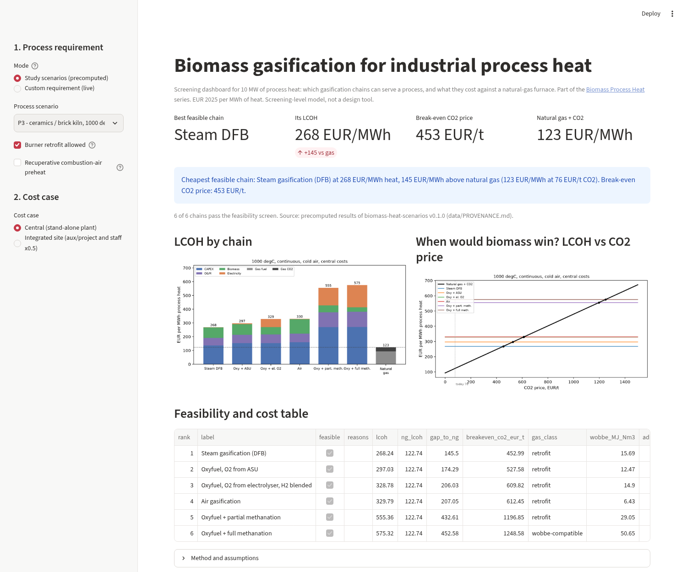
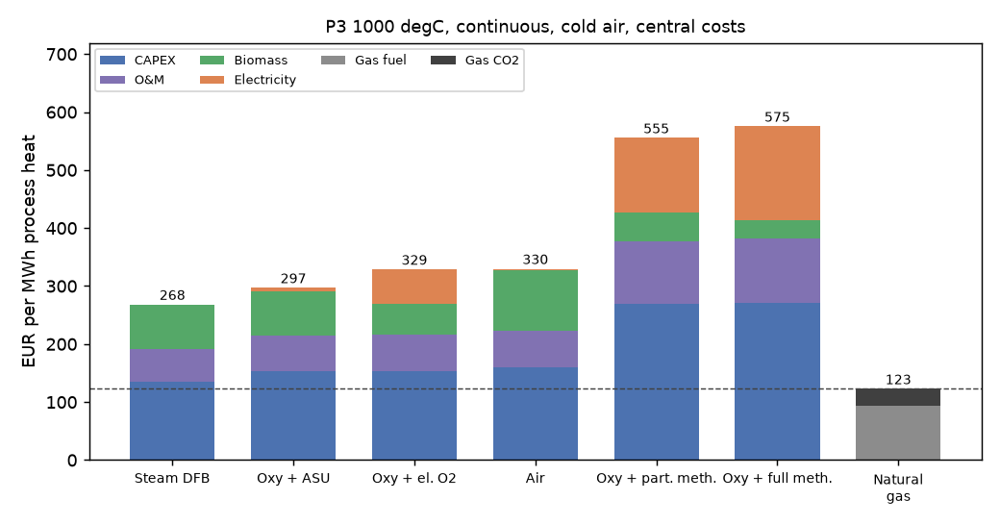
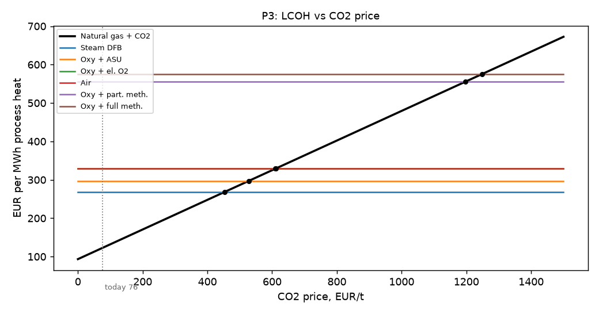
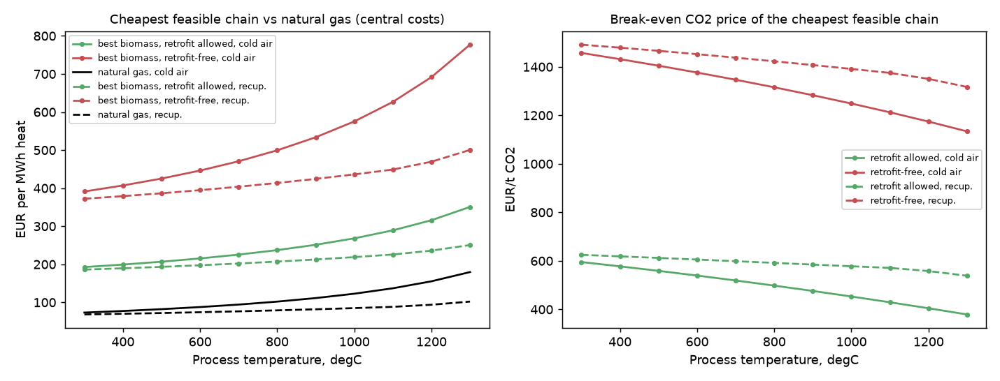

# Biomass Heat Dashboard

**An interactive screen for one question: for _my_ process, which biomass gasification chains
could replace natural gas, and how far are they from it?** You state a heat requirement
(process temperature or one of the four study processes, load profile, whether the burner may be
changed, air preheat, cost case). The app filters the six gasification chains for technical
feasibility and compares their levelised cost of heat (LCOH) and break-even CO2 price against a
natural-gas furnace at the same temperature.

This is step 6 of the [Biomass Process Heat](https://github.com/DataWithSyed/biomass-process-heat)
series. It adds no new physics or cost data. It puts the earlier packages behind a UI:
[`biomass-heat-plant-model`](https://github.com/DataWithSyed/biomass-heat-plant-model) (mass and
energy balances),
[`biomass-heat-electrolysis-dispatch`](https://github.com/DataWithSyed/biomass-heat-electrolysis-dispatch)
(price loading),
[`biomass-heat-lcoh`](https://github.com/DataWithSyed/biomass-heat-lcoh) (`CostInputs`,
`lcoh_breakdown`) and
[`biomass-heat-scenarios`](https://github.com/DataWithSyed/biomass-heat-scenarios)
(`quality.feasibility`, rolling electrolyser dispatch, gas reference).



## Problem

The scenario study (step 5) answers four fixed cases: 300 / 800 / 1000 / 1300 °C. A plant
engineer has one specific process and their own price expectations. They want to see, without
running scripts:

* which chains are technically possible (flame temperature, usable heat, burner compatibility);
* the cheapest feasible chain and its cost structure;
* how high the CO2 price would have to be before biomass beats gas;
* how this moves with gas, CO2, wood and electricity prices, financing and site integration.

## Method

| Layer | What it does |
|---|---|
| `src/bhdash/core.py` | All logic, no Streamlit import. **Precomputed mode** reads the step-5 result matrices (central and integrated-site cost cases, copied with provenance in [`data/PROVENANCE.md`](data/PROVENANCE.md)) and re-applies the `bhscen.quality.feasibility` rule with the user's burner-retrofit choice. **Live mode** rebuilds every chain for any temperature 300–1300 °C, either load profile and either preheat case. `technical()` (design point, load profile, year-long rolling day-ahead electrolyser LP) is cached, so a cost slider only re-runs `bhlcoh.lcoh_breakdown` |
| Feasibility | unchanged from step 5: adiabatic flame ≥ process T + 300 K, ≥ 30 % of fuel LHV usable at process T, and if no burner retrofit is allowed the gas must lie inside the DVGW G 260 H-gas Wobbe band (49.0–55.4 MJ/m³) |
| Gas reference | same furnace and air preheat on natural gas: Eurostat DE band I4 price (excl. taxes) plus the EU ETS price, via `bhscen.evaluate.ng_lcoh` |
| Break-even CO2 | CO2 price at which gas + CO2 equals the biomass LCOH (`bhscen.evaluate.breakeven_co2`). The "LCOH vs CO2 price" chart shows the gas line crossing each (flat) biomass line |
| Electrolyser sizing (live) | Re-optimising electrolyser size and storage takes 9–12 year-long LPs per chain, too slow for a UI. Live runs use the LCOH-optimal size/storage of the nearest study process with the same load profile and preheat |
| `src/bhdash/plots.py` | stacked LCOH bars (infeasible chains hatched) and LCOH-vs-CO2 lines, used by the app and by `scripts/make_figures.py` |
| `app.py` | thin Streamlit layer: sidebar inputs, metrics, two charts, feasibility/cost table, method notes |

`bhlcoh.central_inputs()` reads a data file that the pip-installed `bhlcoh` does not ship. The
dashboard therefore builds costs from `CostInputs()` defaults. These are the same central values
(gas 44.1 EUR/MWh GCV, EUA 76.02 EUR/t, wood chips 30.3 EUR/MWh, 7 %, 20 years). A test checks
that live recompute reproduces the copied matrices to 1e-9.

## Key results surfaced by the dashboard

Reference process P3 (1000 °C kiln, continuous, cold combustion air, central costs). The app
renders the same view as figure 1:





Steam DFB gasification is cheapest at 268 EUR/MWh against 123 for gas + CO2. It breaks even at
453 EUR/t CO2. The other chains cross the gas line between 528 (oxy + ASU) and 1,249 EUR/t
(oxy + full methanation).

**New in this step: a temperature sweep 300–1300 °C** (live recompute, central costs,
continuous duty, `results/temperature_sweep.csv`, `scripts/make_figures.py`). At 300, 1000 and
1300 °C it reproduces the step-5 numbers exactly.



| Process T | Best chain, retrofit allowed (cold air) | LCOH / gas, EUR/MWh | Break-even CO2, EUR/t | Retrofit-free: only oxy + full methanation | Break-even, EUR/t |
|---:|---|---:|---:|---:|---:|
| 300 °C | steam DFB | 193 / 73 | 595 | 391 | 1,457 |
| 600 °C | steam DFB | 215 / 88 | 539 | 446 | 1,376 |
| 800 °C | steam DFB | 237 / 102 | 498 | 500 | 1,316 |
| 1000 °C | steam DFB | 268 / 123 | 453 | 575 | 1,249 |
| 1100 °C | steam DFB | 289 / 137 | 429 | 627 | 1,213 |
| 1300 °C | steam DFB | 351 / 180 | 379 | 777 | 1,134 |

What the dashboard makes visible:

* **The burner decision matters more than any price slider.** If the burner cannot be changed,
  only the fully methanated gas (Wobbe 50.6 MJ/m³, inside the H-gas band) passes at *every*
  temperature from 300 to 1300 °C. The cheapest LCOH then roughly doubles (2.0–2.2× steam DFB).
  The break-even CO2 price rises from 379–595 to 1,134–1,457 EUR/t. In LCOH terms, a burner
  retrofit at 300 EUR/kW adds about 3.5 EUR/MWh (step 5).
* **Break-even CO2 falls steadily with temperature.** It drops from 595 EUR/t at 300 °C to
  379 EUR/t at 1300 °C (cold air, retrofit allowed). The gas furnace loses more heat to the flue
  at high temperature, so each MWh of heat avoids more CO2. This extends step 5: lower
  temperature never helps. Once a burner retrofit is accepted, the hottest process is the best
  biomass candidate per tonne of CO2. The 1000 °C kiln was the best *preset* only because P4 was
  defined as retrofit-free.
* **Recuperation flattens the curve.** With recuperative air preheat the break-even CO2 price
  only falls from 625 to 539 EUR/t over the same range, because gas gains more from preheat.
* Steam DFB is the cheapest retrofit chain at every temperature in the sweep. Air gasification
  fails the 300 K flame-margin rule from 1200 °C upwards without preheat.
* **Sliders (live mode)**: at P3, a CO2 price of 453 EUR/t is needed with today's 44.1 EUR/MWh
  gas. Wood chips move steam DFB by 2.5 MWh_biomass per MWh heat, so +10 EUR/MWh wood adds
  about 25 EUR/MWh heat. The integrated-site cost case lowers DFB to 207 EUR/MWh
  (break-even 295 EUR/t).

## How to run

```bash
python -m venv .venv && source .venv/bin/activate
pip install -r requirements.txt
streamlit run app.py              # http://localhost:8501
pytest -q                         # 20 tests (17 logic + 3 Streamlit AppTest), ~15 s
python scripts/make_figures.py    # README figures + temperature sweep, ~1-2 min
```

In the app, precomputed mode is instant. In live mode, the first evaluation of a new
temperature/profile/preheat combination takes about 3–4 s (three year-long electrolyser LPs).
After that, cost sliders respond immediately. Library use without the UI:

```python
from bhdash import core
v = core.precomputed_view("P4", recuperation=False, retrofit_allowed=True)
core.best_feasible(v)[["config", "lcoh", "breakeven_co2_eur_t"]]   # steam_dfb, 350.8, 379.1

req = core.Requirement(t_process_c=650, profile="continuous", retrofit_allowed=False)
core.live_view(req, core.cost_inputs_for("central", co2_eur_t=150, gas_eur_mwh_gcv=35))
```

Deployment (Streamlit Community Cloud, Docker) is described in [docs/deploy.md](docs/deploy.md).
A CI example is in [docs/ci-example.md](docs/ci-example.md).

## Assumptions

All inherited. Sources and the full assumption register live in the step-5 and step-4 repos
([scenarios docs](https://github.com/DataWithSyed/biomass-heat-scenarios/tree/main/docs),
[LCOH docs](https://github.com/DataWithSyed/biomass-heat-lcoh/tree/main/docs)). The main ones:

* 10 MW of process heat; the scale is fixed in the UI.
* Screening feasibility thresholds (300 K flame margin, 30 % usable heat) are rules of thumb.
* The two-shift profile (Mon–Fri 06–22 h) and the 10 % hot standby are synthetic or assumed.
* Recuperator (effectiveness 0.6, max 700 °C air) is applied to gas and biomass alike and is not
  costed. Burner retrofit is not costed in the LCOH (see the step-5 parametric adder).
* Electricity: one year of real DE-LU day-ahead prices (2025-10-30 → 2026-10-30). The price
  multiplier scales that series and the adder represents grid fees/levies (0 in the central case).
* Live electrolyser sizing is taken from the nearest study process (not re-optimised).

## Limitations

* This is a screening tool. The numbers are point estimates with the uncertainty discussed in
  step 4: the 10k-draw Monte Carlo there found no draw where any chain beats gas at 10 MW.
* No new validation beyond the inherited models. The plant model has no flame dissociation, so
  flame temperatures above about 2000 °C with preheated air are overstated. NOx is not assessed.
* Gas-quality flags compare with public-grid gas limits. They are not burner approvals.
* Live temperatures between the presets reuse preset electrolyser sizing, so electrolyser chains
  may be a few EUR/MWh above their true optimum. In the study matrix the best electrolyser
  chain is 25–94 EUR/MWh behind steam DFB, so small sizing errors are unlikely to change the
  winner. The step-4 sizing optimum was also flat.
* The precomputed matrices are a snapshot of `biomass-heat-scenarios` at commit `6d4711f`. A
  later release of that repo needs a re-copy (see `data/PROVENANCE.md`).

## Repository layout

```
app.py                     Streamlit UI (thin)
src/bhdash/core.py         requirement, precomputed filter/rank, live recompute, CO2 curve, sweep
src/bhdash/plots.py        matplotlib figures used by app and scripts
data/                      step-5 result matrices + DE-LU prices (PROVENANCE.md)
results/temperature_sweep.csv
scripts/make_figures.py    README figures and temperature sweep
tests/                     pytest: logic (17) + Streamlit AppTest smoke tests (3)
docs/deploy.md, docs/ci-example.md
```

## Licence and data

Code: MIT, see [LICENSE](LICENSE). Day-ahead prices: Energy-Charts.info (Fraunhofer ISE),
CC BY 4.0, source Bundesnetzagentur | SMARD.de. Result matrices: from
[biomass-heat-scenarios](https://github.com/DataWithSyed/biomass-heat-scenarios) (MIT).
